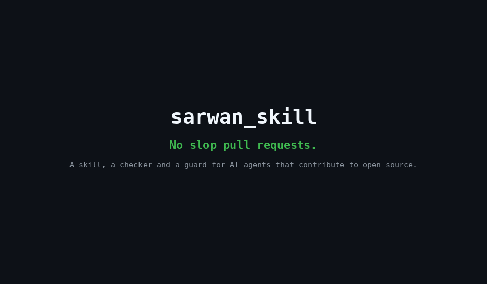

# sarwan_skill

**No slop pull requests.** A skill, a checker and a guard that make AI coding agents good open-source contributors.

[](https://github.com/sarwan-1313/sarwan_skill/actions/workflows/test.yml)
[](LICENSE)
[](CONTRIBUTING.md#ai-contributions)

Before your agent touches someone else's project, it reads that project's AI policy and stops if AI help isn't welcome. It works only on issues maintainers want, keeps the diff small, runs the project's own checks, and writes a short, honest pull request with the disclosure the project asks for. A guard blocks the push if anything is wrong. For maintainers, a second skill writes the rules that agents then follow.



## The two rules agents don't follow

In [RepoComplianceBench](https://arxiv.org/abs/2607.26819) (Peking University, July 2026), four coding agents, Claude Code and Codex among them, scored **0%** on two kinds of project rule: refusing when a project bans AI contributions, and handing the final step to a person when the project asks for that. Reminders and quoting the rule didn't help.

sarwan_skill's guard enforces both at the moment the agent runs `gh pr create`. On 78 real projects ([details and script](eval/refuse-handoff/)):

| Rule | Development set (62 projects) | Unseen projects (16), first run |
| --- | --- | --- |
| The project bans AI contributions | **25/25 blocked** | 5/10 blocked, 5/10 paused for the person |
| A person must submit | **10/10 handed to the person** | 1/3 |
| The project allows AI | 0/37 wrongly blocked | 0/4 wrongly blocked |

The unseen projects' misses were fixed: they are now 9/10 blocked and 3/3 handed off. No pull request to a project whose files ban AI got through silently, in any run.

## Highlights

- **Reads the house rules first.** It finds AI policies in CONTRIBUTING files, AI_POLICY files and PR templates, and it knows the published policies of 189 projects.
- **Stops at the source.** Other anti-slop tools act after a pull request arrives. This one acts before the pull request exists.
- **Enforces, not just advises.** In Claude Code, a hook blocks pushes, pull requests, patch emails and new issues to a project that doesn't accept AI help, and hands the step to you when a project wants a person to submit.
- **Catches the usual slop.** It flags agent files left in the diff, skipped tests, lockfile churn, AI co-author lines, missing changelog entries, filler PR text, and files or functions the text cites that don't exist.
- **Works for both sides.** Contributors get the checks, and maintainers get **ai-policy-writer** to publish rules agents can read exactly.
- **Light and private.** Python standard library only, no network calls by default, and about 400 tokens per session until it's needed.

## Contents

- [The two rules agents don't follow](#the-two-rules-agents-dont-follow)
- [Why](#why)
- [Before and after](#before-and-after)
- [Install](#install)
- [Quick start](#quick-start)
- [How it works](#how-it-works)
- [For maintainers](#for-maintainers)
- [How it compares](#how-it-compares)
- [Tested on real projects](#tested-on-real-projects)
- [FAQ](#faq)
- [Limitations](#limitations)
- [Contributing](#contributing)
- [Acknowledgements](#acknowledgements)
- [License](#license)

## Why

Your agent can open a pull request in seconds. A volunteer then spends much longer reviewing it, and more and more of what they review is slop.

- **About 1 in 4 incoming pull requests is low-quality AI output,** maintainers estimate. At large projects it's 31% ([Linux Foundation Research, Oct 2026](https://openssf.org/press-release/2026/10/30/new-lf-research-survey-shows-generative-ai-cuts-open-source-coding-time-in-half-but-25-of-incoming-pull-requests-are-considered-ai-slop/)).
- **Projects are writing rules, and every one is different.** Of 1,000 popular repositories, 118 have an AI policy. Half of those require you to disclose AI use, each in its own way ([Hora & Robbes, 2026](https://arxiv.org/abs/2605.16706)).
- **Some say no outright.** QEMU declines any contribution it believes includes AI-generated content. Others accept AI help only with an `Assisted-by:` trailer, only for accepted issues, or never from unsupervised agents.

Good agents follow these rules when they find them. Often they don't: the rule lives on a website or deep in the docs, or a smaller model notices it and carries on anyway.

## Before and after

We gave Claude Code the same job with and without sarwan_skill, five times each: fix an issue a maintainer accepted, commit it on a branch and draft the pull request, but send nothing ([method and every run](eval/before-after/)).

| Where the project's AI rule is | Sonnet 5.5 alone | Sonnet 5.5 + sarwan_skill | Haiku 5.5 alone | Haiku 5.5 + sarwan_skill |
| --- | --- | --- | --- | --- |
| CONTRIBUTING.md welcomes AI help with an `Assisted-by:` trailer | Followed it 5 of 5 | Followed it 5 of 5 | Followed it 5 of 5 | Followed it 5 of 5 |
| CONTRIBUTING.md says AI help is not accepted | Stopped 5 of 5 | Stopped 5 of 5 | Stopped 2 of 5 | Stopped 5 of 5 |
| Only the project's website says no ([Click](https://palletsprojects.com/contributing/llm-ai)) | Stopped 0 of 5 | Stopped 5 of 5 | Stopped 0 of 5 | Stopped 3 of 5 |

- **When the rule is plainly in the repository,** Sonnet follows it with or without the skill. There the skill only adds cost, a few cents a run.
- **When the rule lives elsewhere,** the skill is the difference. Click's repository says nothing about AI, but the Pallets website tells new contributors not to use AI tools at all. Without the skill, Sonnet prepared the pull request every time. With it, Sonnet stopped every time and told the person which policy applied.
- **Smaller models need it more.** Haiku warned the person about the ban every time, then wrote and committed the fix anyway in 3 of 5 runs, with an AI co-author line. With the skill, it stopped every time. On Click it stopped 3 of 5 times; in the other two it never opened the skill. The guard would still have blocked a push, but these runs were told not to send anything.

## Install

You need Python 3.9 or newer and git. The [GitHub CLI](https://cli.github.com) (`gh`) is optional and is used only for the live GitHub checks.

**Claude Code** (recommended). This installs both skills and the guard:

```
/plugin marketplace add sarwan-1313/sarwan_skill
/plugin install sarwan-skill@sarwan-skill
```

**Codex, Cursor, Gemini CLI and dozens of other agents**, with the [skills CLI](https://github.com/vercel-labs/skills):

```bash
npx skills add sarwan-1313/sarwan_skill -g
```

**By hand:** copy the folders inside `skills/` into your agent's skills folder, such as `~/.claude/skills/` (Claude Code), `~/.agents/skills/` (Codex), `~/.cursor/skills/` (Cursor) or `~/.gemini/skills/` (Gemini CLI).

Outside Claude Code, add the guard as git hooks (before `git push` and `git send-email`) in each repository you contribute to:

```bash
python3 path/to/sarwan-skill/scripts/guard.py install
```

## Quick start

**See it catch slop in two minutes, no agent needed.** This builds a small project with a typical sloppy AI change:

```bash
git clone https://github.com/sarwan-1313/sarwan_skill
sh sarwan_skill/demo/slop_demo.sh demo-project
cd demo-project
python3 ../sarwan_skill/skills/sarwan-skill/scripts/check.py all --pr ../pr.md
```

**Then use it for real.** After installing, work as usual:

> Fix issue #123 in owner/repo and get a pull request ready.

The skill switches on when the work is headed to someone else's repository. Your agent reads the rules, checks the issue, keeps the change small, runs the project's tests, and hands you a short draft to review. You submit it yourself.

## How it works

### The five rules

| Rule | In one line | What it prevents |
| --- | --- | --- |
| **1. Knock first** | Read the house rules before touching anything | PRs to projects that don't accept AI help; ignored contribution guides |
| **2. No issue, no PR** | Work only on something the maintainers want | Drive-by PRs, duplicate PRs, unconfirmed bug reports |
| **3. Smallest diff that solves it** | Every changed line traces back to the issue | Reformatting, "while I'm here" refactors, stray agent files |
| **4. Prove it with their tools** | Run what the project runs; report what actually happened | "All tests pass" when nothing ran; skipped or weakened tests |
| **5. Write like the person who will own it** | Short, specific, honest, disclosed | Filler PR text, AI co-author tags, agents submitting on their own |

The full skill is one short file: [skills/sarwan-skill/SKILL.md](skills/sarwan-skill/SKILL.md). [EXAMPLES.md](EXAMPLES.md) shows each rule in action.

### The checker

Agents drift away from rules in long sessions, so the agent runs a checker at each step. It points at exact lines; the agent and the person decide what to do.

```bash
CHECK=path/to/sarwan-skill/scripts/check.py
python3 $CHECK policy            # what this project allows, and how to disclose
python3 $CHECK diff              # your change, before anyone else sees it
python3 $CHECK pr /tmp/pr.md     # your pull request description
python3 $CHECK all --pr /tmp/pr.md
python3 $CHECK report /tmp/bug.md   # a bug or security report, before it's filed
```

A typical slop contribution, caught (from the [quick start](#quick-start), shortened):

```
== Your change
  FIX    CLAUDE.md (added) is a file for your own AI tooling.
  FIX    Added package-lock.json, but the project uses yarn.lock.
  FIX    Added a skipped or disabled test in tests/test_parse.py.
  FIX    Commit d8aad1d lists an AI tool as Co-authored-by.

== Pull request text
  FIX    4 emoji. Drop them; they read as generated text.
  FIX    Generic filler words: comprehensive, robust, seamless, leverage, best practices.
  FIX    Says nothing about testing.

Result: Fix the items marked FIX, then run this again.
```

The full output also says how to fix each one.

- **What it reads:** AI policy files, CONTRIBUTING guides, PR and issue templates, `AGENTS.md`, and the commands the project's CI runs. It understands scope, so "don't use AI for issues" is a condition, while "we decline AI-generated contributions" is a stop. It also notices when the project needs a signed CLA or a DCO sign-off, which only the person can give.
- **What it knows:** the published policies of 189 projects, from the public-domain [open-source AI contribution policies](https://github.com/melissawm/open-source-ai-contribution-policies) list. That lets it stop even when a policy lives on a website, as with Flask, Servo, Gentoo and Zig.
- **What it catches in your change:**
  - your own AI tool files, notes, plans, and editor or secret files;
  - whitespace-only edits, lockfile churn and the wrong package manager;
  - deleted or skipped tests and weakened assertions;
  - debug leftovers, AI `Co-authored-by` and "Generated with" lines, and changes too big to review;
  - a missing changelog entry when the project keeps one: a news fragment (towncrier, changesets, reno, scriv or a `changelog.d` folder) or a CHANGELOG line its guide asks for.
- **What it catches in your text:** files, line numbers and functions that the PR description or bug report mentions but the repository doesn't have, a common sign it was written without reading the code. Bug reports also need a way to reproduce, a version and an expected result, and security reports get sent the private way.

### The guard

Rules are advice; the guard makes them stick. With the Claude Code plugin, the checks run by themselves right before work leaves for a project you don't own: `git push`, a pull request (`gh pr create`, `glab mr create`), a patch email (`git send-email`, `b4 send`) or a new issue (`gh issue create`).

| Situation | What happens |
| --- | --- |
| The project doesn't accept AI help | The command is blocked, and the agent is told to stop and tell you |
| The project wants a person, not an agent, to submit | You're asked before the pull request, issue or patch email goes out, with the rule quoted |
| Something needs fixing | You're asked before the command runs, with the list of problems |
| All clear, or it's your own repository or fork | Nothing |

It was tested in real Claude Code sessions: a push and a patch email to a project that bans AI help were blocked, and an issue citing a function that doesn't exist was held for the person to approve. You can switch the guard off for one command with `SARWAN_SKILL_GUARD=off`. The skill tells agents never to do that themselves.

### Live GitHub checks

Only when you ask, and only through the GitHub CLI:

```bash
python3 $CHECK issue 123         # open? accepted? already claimed? duplicate PRs? if taken, what else is open
python3 $CHECK policy --online   # also read the organization's .github policy
```

## For maintainers

Ask your agent to **"write an AI contribution policy for this project"**. The **ai-policy-writer** skill:

1. shows what 189 real projects decided, with links;
2. asks you six questions, each with a suggested answer;
3. writes a short "AI contributions" section for `CONTRIBUTING.md`, a policy block, a PR template item, an `AGENTS.md` note and a badge;
4. checks the result the way contributing agents will read it, and warns you if your prose and your block disagree.

The block is six lines, and you can also write it by hand:

```ai-contribution-policy
version: 1
ai-assistance: allowed        # allowed | ask-first | not-accepted
disclosure: assisted-by       # assisted-by | pr-description | both | not-needed
issue-first: yes
agent-opened-prs: no
human-written-text: no
```

[POLICY_BLOCK.md](POLICY_BLOCK.md) explains every line and has badges you can add to your README.

## How it compares

| Tool | Who it works for | Helps follow the project's AI policy | Stops a bad PR before it's sent |
| --- | --- | --- | --- |
| GitHub's maintainer controls | Maintainers | No | Only by limiting who can open PRs at all |
| Anti-slop GitHub Actions and AI review bots | Maintainers | No | No, they act on PRs already opened |
| Test guards such as [TDD Guard](https://github.com/nizos/tdd-guard) | Contributors | No | No, they guard tests while coding |
| Coding rule sets such as [Karpathy's](https://github.com/multica-ai/andrej-karpathy-skills) | Contributors | No | No |
| **sarwan_skill** | **Both** | **Yes** | **Yes, with the guard** |

These tools solve different problems and work well together. sarwan_skill covers the gap between them: the contributor's machine, before anything is sent.

## Tested on real projects

The policy reader was checked against the published AI policies of 72 real projects ([eval/](eval/)). On the last 32, which the patterns had never seen, it agreed with the public policy list on 27, said "unclear, ask the person" on 4, and misread 1. Those wordings are now fixed and covered by tests. The guard itself was then run on 78 projects ([eval/refuse-handoff/](eval/refuse-handoff/)), as summarized [at the top](#the-two-rules-agents-dont-follow). In all, 110 automated tests cover the checker, the guard, the policy writer and the before-and-after scoring.

## FAQ

**Doesn't this help AI pull requests sneak past maintainers?**
No, it does the opposite. It stops at projects that don't accept AI help, makes the agent disclose in the project's own format, and forbids rewording a change to hide AI use. The problems it fixes are the ones maintainers complain about.

**Does it send my code anywhere?**
No. The checker reads files and runs git on your machine. Only `issue` and `--online` contact GitHub, through the GitHub CLI, when you ask.

**Will it get in the way in my own projects?**
No. The rules apply only when work is headed to a repository you don't own. The guard ignores pushes to your own repositories and forks.

**Can the agent turn the guard off?**
The skill tells it never to, and doing so would show in the command it runs. The guard is a guardrail, not a sandbox, so keep reviewing what your agent does.

**Does it work outside Claude Code?**
Yes. The skills use the open [Agent Skills](https://agentskills.io) format, and the guard is also available as git hooks. On Windows, the guard currently needs `python3` on your PATH.

## Limitations

- The policy reader matches patterns, so a policy written in a new way can be misread. That's why it always quotes the lines it relied on, and the agent reads them.
- It can only see policies that live on a website when the project is in its list of 189.
- It catches common slop, not every mistake. The fact check matches names, so a wrong function that shares its name with a real one gets through. A person still reviews the change.
- It's slower than "just open the PR". That's on purpose: every pull request costs a maintainer real time.

## Contributing

Contributions are welcome. This repository follows its own rules: read [CONTRIBUTING.md](CONTRIBUTING.md), which includes our policy block. The most useful first contribution is a report of a real policy the checker misreads, with the project, the file and the line. See [CHANGELOG.md](CHANGELOG.md) for what changed in each release.

## Acknowledgements

- Inspired by [andrej-karpathy-skills](https://github.com/multica-ai/andrej-karpathy-skills): a few clear rules can fix a failure everyone recognizes.
- Policy data from [open-source-ai-contribution-policies](https://github.com/melissawm/open-source-ai-contribution-policies) by [@melissawm](https://github.com/melissawm) and contributors (CC0).
- Research by the [Linux Foundation](https://openssf.org/press-release/2026/10/30/new-lf-research-survey-shows-generative-ai-cuts-open-source-coding-time-in-half-but-25-of-incoming-pull-requests-are-considered-ai-slop/) and [Hora & Robbes](https://arxiv.org/abs/2605.16706).

Built by [@sarwan-1313](https://github.com/sarwan-1313).

## License

[MIT](LICENSE)
